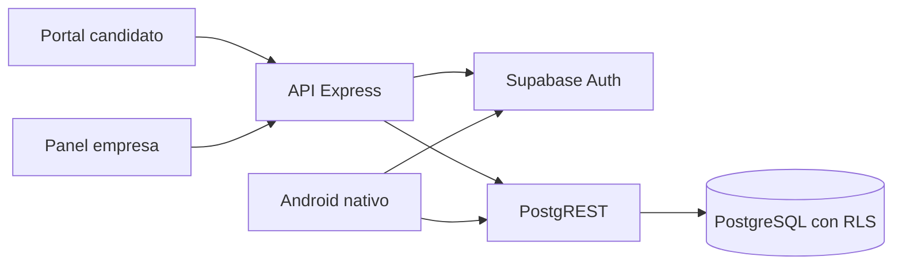
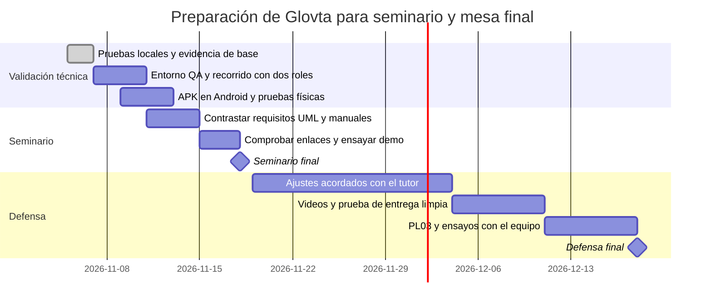

# Glovta · Aceptación de empleabilidad y plan de defensa

| Requisito | Actor y resultado esperado | Evidencia actual | Aceptación pendiente |
|---|---|---|---|
| RF-E01 Publicar una oferta | Una empresa habilitada publica con su identidad registrada. | PostgreSQL local y prueba de interfaz. | Repetir desde el portal con Supabase Auth de evaluación. |
| RF-E02 Buscar y postularse | Una persona con perfil encuentra la oferta vigente y envía su presentación. | Prueba de búsqueda, envío y restricciones de base. | Registrar la versión de web y la cuenta de evaluación. |
| RF-E03 Recuperar la solicitud | Al volver a ingresar, la persona ve la postulación y su estado. | Reconexión SCRAM en PostgreSQL y reingreso web con API simulada. | Repetir el recorrido integrado en evaluación. |
| RF-E04 Resolver solicitudes | La empresa pasa de enviada a revisión y decide aceptación o rechazo. | PostgreSQL acepta el recorrido y rechaza saltos y reapertura. | Probar estados de dos candidatos ante el tutor. |
| RNF-E01 Aislamiento | Cada empresa accede a sus ofertas y solicitudes. El candidato consulta las propias. | Prueba con tres conexiones independientes. | Validar políticas instaladas y pertenencia real en Supabase de evaluación. |
| RNF-E02 Integridad | Dos envíos para la misma persona y oferta producen una sola postulación. | Restricción única y rechazo PostgreSQL 23505. | Verificar tratamiento HTTP de duplicados en evaluación. |
| RNF-E03 Accesibilidad | Completar el recorrido con teclado, zoom y lector de pantalla. | Controles automáticos en tres tamaños en las vistas de candidato. | Prueba manual de empresa y candidato, Android con TalkBack. |

## Componentes y responsabilidades

## Cronograma propuesto

Las fechas intermedias son objetivos de trabajo. El ensayo de seminario es el 18 de noviembre y la defensa final el 18 de diciembre de 2026. El grupo debe confirmar responsables y disponibilidad antes de presentar el Gantt como compromiso.

