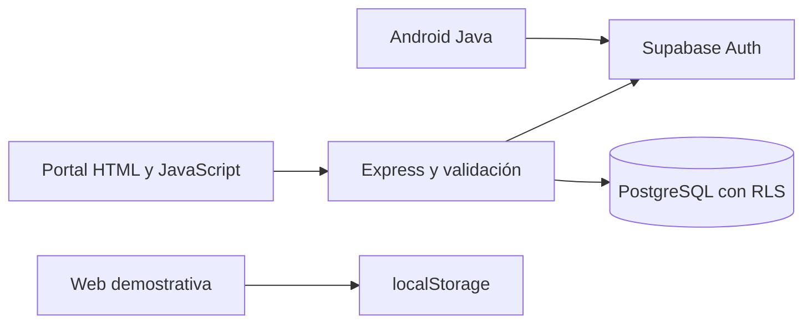

# Glovta avance funcional del 4 de noviembre
## Implementación
Se agregó portal.html con login, perfil, oportunidades y postulaciones mediante API del mismo origen. Acceso desde Mi espacio en la navegación principal. Conserva los módulos demo existentes. Sesión y refresh token viven en memoria y se pierden al recargar. Cerrar sesión borra datos del cliente, pero no revoca el token remoto. Registro, recuperación y revocación global pendientes.
server/auth.js incorpora POST /api/auth/login y /api/auth/refresh. Las rutas privadas existentes siguen verificando identidad con Supabase. La renovación concurrente en el portal se agrupa en una única petición. No hay datos de ejemplo en el portal conectado.
Android corrige el acceso a setAccessibilityHeading para API 26 y 27. Su login aún requiere integración de sesión y navegación.
## Requisitos y casos
| ID | Requisito y caso de uso | Aceptación | Estado |
| --- | --- | --- | --- |
| RF01 | Persona inicia sesión | Credenciales inválidas no acceden | API probada con proveedor simulado |
| RF02 | Persona edita perfil | Guarda solo perfil propio | API probada; portal implementado |
| RF03 | Persona consulta oportunidades | Lista publicadas o estado vacío | Portal implementado; base remota pendiente |
| RF04 | Persona se postula | Propietario verificado, duplicado rechazado | API probada; recorrido remoto pendiente |
| RF05 | Persona consulta postulaciones | Solo registros propios | API y portal implementados |
| RNF01 | Proteger credenciales | No persistir tokens ni contraseña en almacenamiento web | Tokens en memoria, contraseña limpiada |
| RNF02 | Fallas visibles | Configuración ausente produce error, nunca éxito | Prueba de navegador aprobada |
| RNF03 | Uso móvil accesible | Etiquetas, foco visible, estado anunciado y sin desborde | Verificación parcial a 390px; WCAG completa pendiente |
## Arquitectura y componentes

## Manual web de esta versión
Ejecutar npm ci y configurar .env a partir de .env.example con URL y clave pública de Supabase. Ejecutar npm start. Abrir /portal.html en el servidor Express. Usar una cuenta existente, completar nombre y guardar perfil. Actualizar oportunidades y elegir Postularme. Consultar el resultado en Mis postulaciones. Cerrar sesión elimina los datos visibles. Sin Supabase configurado se muestra el error correspondiente. Un hosting estático como Vercel requiere configurar la API del mismo origen antes de utilizar este portal.
## Pruebas
npm test aprobó 11 pruebas. Tres nuevas cubren validación y fallos de login, contrato de login y renovación, y disponibilidad de recursos y error por configuración ausente.
node scripts/verify-portal.cjs aprobó el caso sin configuración, limpieza de contraseña y ausencia de desborde a 390px en Edge headless. Captura output/qa/portal-mobile.png.
Estas pruebas usan dependencias simuladas o configuración ausente. Pendiente recorrer datos reales con cuentas por rol.
## Matriz de calidad
Puntaje conservador provisional de criterios acreditados, no calificación académica.
| Área | Máximo | Acreditado | Brecha |
| --- | --- | --- | --- |
| Funcionalidad | 25 | 5 | Falta integración real, roles, asesorías, formación y Android completo |
| Arquitectura y seguridad | 20 | 6 | Validaciones e identidad en API probadas; auditoría y RLS remotas pendientes |
| UX y accesibilidad | 20 | 4 | Estilos, etiquetas y prueba móvil parcial; evaluación WCAG pendiente |
| Testing | 15 | 5 | 11 tests y navegador parcial; falta integración, carga y dispositivo |
| Documentación | 15 | 4 | Auditoría y contrato parcial; manuales y diagramas finales pendientes |
| Defensa | 5 | 1 | Guion existente; falta ensayo integral |
| Total | 100 | 25 | Provisional, sujeto a revisión con evidencia adicional |
## Prioridades y planificación
1. Configurar entorno de evaluación y probar RLS con usuarios diferentes.
2. Completar sesión Android, registro y recuperación. Añadir límites de intentos y revocación según proveedor.
3. Implementar empresas y administrador con autorización de servidor y esquema revisado.
4. Conectar asesorías con responsables y estados, luego formación e IA acotada.
5. Revisar reintentos, concurrencia del perfil, pruebas de navegador conectado y seguridad de dependencias.
6. Preparar APK final, manuales, videos, diagrama de clases y Gantt detallado.
El calendario objetivo permanece en el informe de auditoría. La fecha 18/11 exige revisar alcance según resultados reales.
## Uso de IA y trazabilidad
Cambios generados con asistencia de Codex y comprobados mediante pruebas indicadas. El estudiante debe explicar HTTP, tokens, RLS, validación y límites del prototipo. Se mantienen pendientes los commits hasta comparar esta carpeta sin historial con el repositorio remoto. No se publicaron cambios ni se ejecutaron migraciones.

## Cierre de verificaciones de esta sesión
Android assembleDebug terminó con BUILD SUCCESSFUL. Sigue pendiente probar la versión corregida en Android 26/27 y dispositivo físico.
npm audit detectó avisos en body-parser y qs. npm audit fix actualizó dos dependencias dentro de los rangos compatibles. El resultado posterior informó cero vulnerabilidades conocidas y npm test volvió a aprobar las 11 pruebas. Esto no reemplaza una auditoría completa de seguridad.
Archivos de aplicación modificados: index.html, server/app.js, android/app/src/main/java/com/glovta/app/MainActivity.java y package-lock.json. Nuevos: server/auth.js, portal.html, portal.js, portal.css. Pruebas: test/backend.test.js y scripts/verify-portal.cjs. Documentación: README.md y este informe. Evidencias: output/qa/dependency-audit.json y output/qa/portal-mobile.png.
