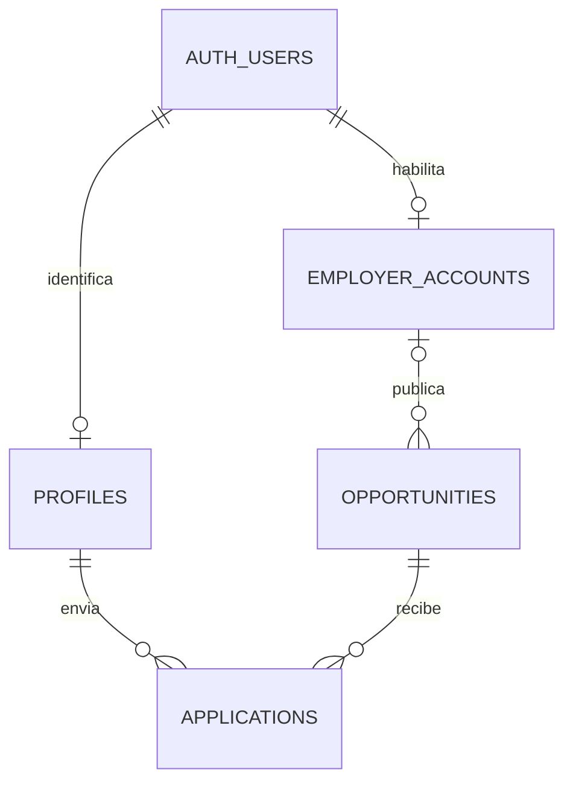

# Empleabilidad de Glovta

El catálogo histórico `jobs` contiene los dos registros visibles en la captura inicial. El portal actual lista `opportunities`. Una fila puede existir y quedar fuera del catálogo por su estado o por su fecha de cierre. Un administrador puede distinguir esos casos con esta consulta de lectura:

```sql
select count(*) as total,
       count(*) filter (where status = 'draft') as borradores,
       count(*) filter (where status = 'closed') as cerradas,
       count(*) filter (where status = 'published' and closes_at <= now()) as vencidas,
       count(*) filter (where status = 'published' and (closes_at is null or closes_at > now())) as vigentes
from public.opportunities;
```

## Manual breve de evaluación web

1. **Empresa**. Iniciá sesión, entrá en Oportunidades y abrí Gestión de empresa. Completá el puesto, ubicación y descripción. Elegí Publicar oportunidad y comprobá que aparezca en el catálogo.
2. **Candidato**. En otra sesión, completá el nombre de tu perfil y guardalo. Buscá el puesto, adjuntá una breve presentación si querés y elegí Postularme. Una solicitud enviada queda marcada en el catálogo.
3. **Empresa**. Usá Actualizar oportunidades y postulaciones. En Postulaciones recibidas, pasá la solicitud a revisión. Después elegí Aceptar o Rechazar. Cada decisión se aplica a esa solicitud.
4. **Candidato**. Cerrá sesión y volvé a ingresar. En Oportunidades → Mis postulaciones, verificá el título y el estado.

## Modelo y permisos



Las ofertas históricas admiten titular vacío. En el flujo nuevo, PostgreSQL exige una membresía válida y que titular y empresa coincidan. La restricción única sobre candidato y oferta evita duplicados. La empresa accede a las solicitudes de sus ofertas y solo puede actualizar el estado. La política de candidato permite insertar para su propia identidad. La transición admitida va de enviada a revisión y después a aceptada o rechazada. Los estados finales conservan la decisión.

## Cómo repetir

- **Base aislada**. Con Node, las dependencias de QA `embedded-postgres` y `pg` accesibles por `NODE_PATH`, ejecutar `node scripts/verify-employment-db.cjs`. Inicializa un clúster temporal, aplica las tres migraciones del repositorio, crea cuentas con contraseñas aleatorias y lo detiene al terminar. Implementa `auth.uid()` mediante la identidad de conexión para probar los permisos del motor. El informe menciona explícitamente ese alcance.
- **Interfaz local**. Con Playwright y Edge, ejecutar `node scripts/verify-employer-portal.cjs`. El modo predeterminado usa datos sintéticos y respuestas HTTP de prueba.
- **Supabase de evaluación**. Preparar un proyecto independiente, aplicar allí las tres migraciones revisadas y asignar una fila en `employer_accounts` al UID de la cuenta de empresa desde administración. La cuenta candidata debe tener su presentación guardada. Configurar en el entorno local `QA_STAGE_REF`, `SUPABASE_URL`, `SUPABASE_PUBLISHABLE_KEY`, `QA_COMPANY_EMAIL`, `QA_COMPANY_PASSWORD`, `QA_CANDIDATE_EMAIL` y `QA_CANDIDATE_PASSWORD`. El mismo script levanta un servidor en loopback y comprueba que la referencia coincida con la URL y difiera de producción. Esta prueba deja una oferta identificada como demo y una postulación en evaluación para inspeccionar. El módulo se habilita en el servidor con `GLOVTA_EMPLOYER_ENABLED=true`.
